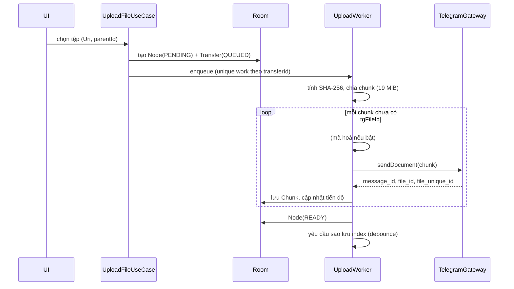

# SPEC.md — TgVault (tên tạm): ứng dụng Android dùng Telegram làm nơi lưu trữ dữ liệu

> Phiên bản: 1.0 (bản nháp đầu) · Ngôn ngữ tài liệu: tiếng Việt, thuật ngữ kỹ thuật giữ nguyên tiếng Anh
> Đọc cùng với `PLAN.md` (kế hoạch build theo milestone). Mỗi yêu cầu có mã (ví dụ `FR-FILE-2`) để PLAN tham chiếu.
> Quy ước: **PHẢI** = bắt buộc, **NÊN** = mặc định tốt nhất, trừ khi có lý do ghi lại trong `docs/DECISIONS.md`, **CÓ THỂ** = tuỳ chọn.

---

## 1. Tổng quan

TgVault là app Android biến một **channel riêng tư trên Telegram của chính người dùng** thành ổ đĩa đám mây cá nhân. Người dùng tải tệp lên, duyệt theo thư mục, xem trước, tải về, chia sẻ, xoá. Không có server của chúng ta: app nói chuyện trực tiếp với Telegram Bot API bằng bot do người dùng tự tạo.

**Mục tiêu**
1. Lưu tệp (kể cả tệp lớn hơn giới hạn của Telegram) bằng cách chia nhỏ (chunk) và ghép lại.
2. Trải nghiệm thân thiện: onboarding có hướng dẫn từng bước, giao diện Material 3 hiện đại, animation nhẹ và mượt.
3. Riêng tư: tuỳ chọn mã hoá đầu-cuối phía client trước khi gửi lên Telegram.
4. Bền: truyền tải chạy nền, tiếp tục được sau khi mất mạng hoặc app bị kill, khôi phục được danh mục tệp trên thiết bị mới.

**Ngoài mục tiêu (MVP)**: chia sẻ link công khai, cộng tác nhiều người, đồng bộ thời gian thực nhiều thiết bị, tự động sao lưu ảnh, phát video streaming (xem backlog trong `PLAN.md`).

---

## 2. Giả định và quyết định kiến trúc đã chốt

Giả định lớn nhất: yêu cầu "dùng Telegram làm nơi lưu trữ dữ liệu" được hiểu là **ứng dụng lưu tệp kiểu cloud drive**. Nếu thực tế là lưu dữ liệu có cấu trúc (ghi chú, danh bạ, JSON), kiến trúc vẫn dùng lại được (chunk, index, mã hoá) nhưng phần UI cần thiết kế lại.

| # | Quyết định | Lý do | Đánh đổi |
|---|---|---|---|
| D1 | Dùng **Telegram Bot API (HTTPS)** do người dùng tự tạo bot qua @BotFather; lưu vào **channel riêng tư** | Không cần thư viện native, onboarding đơn giản, an toàn hơn đăng nhập tài khoản người dùng | Bot API không đọc được lịch sử channel → phải có **index cục bộ** + sao lưu index lên Telegram (mục 11) |
| D2 | Giới hạn của Bot API công cộng: **upload 50 MB, getFile download 20 MB**. Chunk mặc định **19 MiB (19.922.944 byte)** | Nhỏ hơn 20 MB theo cả hai cách hiểu (MB/MiB) nên mọi chunk đều tải lại được bằng `getFile` | Tệp 1 GB ≈ 54 tin nhắn; bị giới hạn bởi rate limit |
| D3 | Truy cập Telegram qua interface `TelegramGateway` | Sau này thay bằng Local Bot API server (upload tới 2000 MB, download không giới hạn) hoặc TDLib mà không đụng domain/UI | Thêm một lớp trừu tượng |
| D4 | **Kotlin + Jetpack Compose + Material 3** | Compose chỉ dùng Kotlin; hệ sinh thái Android hiện đại (Hilt, Room, WorkManager) đều ưu tiên Kotlin | Người quen Java Spring Boot cần làm quen cú pháp Kotlin (rất gần Java; xem phụ lục A) |
| D5 | Một module Gradle `:app`, chia package theo layer + feature | Giữ đơn giản cho AI agent; có thể tách module sau | Build chậm hơn khi lớn |
| D6 | **Room là nguồn sự thật (source of truth)** của danh mục tệp | Duyệt nhanh, hoạt động offline | Phải sao lưu index (FR-IDX-*) |
| D7 | `minSdk 29` (Android 10), `targetSdk` theo yêu cầu Google Play hiện hành (agent PHẢI kiểm tra khi bootstrap) | Scoped storage, không phải viết code legacy cho quyền lưu trữ | Bỏ máy Android 9 trở xuống; hạ minSdk được nếu muốn |
| D8 | Mã hoá phía client **tuỳ chọn**, dùng Tink (không tự viết crypto) | Cloud chat của Telegram không phải E2E; người dùng cần tuỳ chọn riêng tư | Mất passphrase = mất dữ liệu đã mã hoá |
| D9 | Hỗ trợ **một "drive"** (một bot + một channel) ở MVP | Giảm phạm vi | Nhiều drive nằm trong backlog |

---

## 3. Phạm vi MVP

**Trong phạm vi**: onboarding + kết nối bot/channel, duyệt/tạo/đổi tên/di chuyển/xoá (thùng rác) tệp và thư mục, upload/download chunked chạy nền có resume, preview ảnh/văn bản/PDF, mở tệp khác bằng app ngoài, tìm theo tên, chọn nhiều, share-in/share-out, sao lưu và khôi phục index, mã hoá tuỳ chọn, khoá app bằng sinh trắc học, cài đặt, đa ngôn ngữ (vi, en), giao diện sáng/tối/dynamic color.

**Ngoài phạm vi**: xem mục 1. Không có phân tích (analytics), không có quảng cáo, không có backend riêng.

---

## 4. Yêu cầu chức năng

### 4.1 Onboarding và kết nối
- **FR-ONB-1**: Nhập bot token, gọi `getMe` để kiểm tra; hiển thị tên bot khi hợp lệ. Có nút Dán (paste) và nút mở @BotFather (`https://t.me/BotFather`).
- **FR-ONB-2**: Tự phát hiện channel: gọi `deleteWebhook`, rồi `getUpdates` (long polling, `allowed_updates=["my_chat_member","channel_post"]`) để bắt sự kiện bot được thêm vào channel; lấy `chat.id`. Có lối thoát nhập tay (`@username` hoặc `-100…`).
- **FR-ONB-3**: Kiểm tra quyền của bot trong channel (`getChatMember` của chính bot): cần *Post messages*, *Delete messages*, *Pin messages*. Hiển thị checklist; thiếu quyền nào thì chỉ cách sửa.
- **FR-ONB-4**: Bước chọn mã hoá (bật/tắt, đặt passphrase, cảnh báo rõ khi mất passphrase).
- **FR-ONB-5**: Luồng "Khôi phục từ Telegram": nhập token + channel → `getChat` lấy `pinned_message` → tải index → (nếu có mã hoá) nhập passphrase → khôi phục.

### 4.2 Quản lý tệp
- **FR-FILE-1**: Duyệt theo thư mục với breadcrumb, chế độ danh sách/lưới, sắp xếp theo tên / ngày / kích thước, tăng/giảm.
- **FR-FILE-2**: Upload nhiều tệp qua `ACTION_OPEN_DOCUMENT` (cho phép chọn nhiều) và qua share-in (`ACTION_SEND`, `ACTION_SEND_MULTIPLE`).
- **FR-FILE-3**: Download/export tệp ra vị trí người dùng chọn (SAF `CREATE_DOCUMENT`, hoặc thư mục tải về mặc định đã nhớ bằng `OPEN_DOCUMENT_TREE`).
- **FR-FILE-4**: Tạo thư mục, đổi tên, di chuyển (cây thư mục chọn đích). Tên trùng trong cùng thư mục tự thêm hậu tố `(1)`, `(2)`.
- **FR-FILE-5**: Xoá mềm vào thùng rác 30 ngày; khôi phục; xoá vĩnh viễn (gọi `deleteMessage` cho từng chunk); dọn thùng rác tự động.
- **FR-FILE-6**: Tìm theo tên (không phân biệt hoa thường, bỏ dấu tiếng Việt). Dùng `LIKE` trên cột tên đã chuẩn hoá (`nameNormalized`), chưa cần FTS.
- **FR-FILE-7**: Chọn nhiều (nhấn giữ) và thao tác hàng loạt: tải về, di chuyển, xoá, chia sẻ.
- **FR-FILE-8**: Chia sẻ ra ngoài: tải về cache rồi mở share sheet qua `FileProvider`.

### 4.3 Truyền tải
- **FR-TR-1**: Hàng đợi upload/download chạy nền (WorkManager + foreground service loại `dataSync`), sống sót khi app bị kill.
- **FR-TR-2**: Tạm dừng, tiếp tục, huỷ, thử lại từng tác vụ và toàn cục.
- **FR-TR-3**: Resume theo chunk: chunk nào đã có `tgFileId` thì bỏ qua khi tiếp tục.
- **FR-TR-4**: Tuỳ chọn "Chỉ dùng Wi-Fi" (WorkManager constraint `UNMETERED`).
- **FR-TR-5**: Thông báo tiến trình (một thông báo gộp, cập nhật tối đa 1 lần/giây) và thông báo hoàn tất/lỗi. Xin quyền `POST_NOTIFICATIONS` đúng lúc (khi bắt đầu upload đầu tiên) kèm giải thích.
- **FR-TR-6**: Toàn vẹn: lưu SHA-256 của tệp gốc khi upload; xác minh sau khi ghép khi download; lệch thì báo lỗi, không đánh dấu thành công.

### 4.4 Xem trước
- **FR-PRV-1**: Ảnh: xem toàn màn hình, zoom/pan, vuốt xuống để đóng.
- **FR-PRV-2**: Văn bản thuần (`text/*`, tối đa 1 MiB hiển thị đầu tệp).
- **FR-PRV-3**: PDF qua `PdfRenderer` (nền tảng).
- **FR-PRV-4**: Loại khác (video, audio, zip…): tải về cache rồi mở bằng app ngoài (`ACTION_VIEW`). Streaming nằm trong backlog.
- Thumbnail: tạo cục bộ cho ảnh (tối đa 320 px, WebP), lưu cache; tệp khác dùng icon theo loại.

### 4.5 Index
- **FR-IDX-1**: Tự động sao lưu index sau khi thay đổi (debounce: tối đa 1 lần / 10 phút, và khi hàng đợi truyền tải rỗng).
- **FR-IDX-2**: Nút "Sao lưu ngay" trong Cài đặt.
- **FR-IDX-3**: Khôi phục index trên thiết bị mới (FR-ONB-5).
- **FR-IDX-4**: Phát hiện xung đột: nếu `revision` trên Telegram lớn hơn bản cục bộ, hỏi người dùng (ghi đè cục bộ / giữ cục bộ). MVP không merge.

### 4.6 Bảo mật
- **FR-SEC-1**: Mã hoá tuỳ chọn (mục 12).
- **FR-SEC-2**: Khoá app bằng sinh trắc học/PIN thiết bị (`BiometricPrompt`), khoá khi app vào nền quá 1 phút (cấu hình được).
- **FR-SEC-3**: Bot token lưu mã hoá bằng Tink AEAD + Android Keystore; KHÔNG ghi log token.
- **FR-SEC-4**: Tuỳ chọn ẩn nội dung ở màn hình recent apps (`FLAG_SECURE`), mặc định bật khi khoá app được bật.

### 4.7 Cài đặt
- **FR-SET-1**: Tài khoản Telegram (tên bot, channel, kiểm tra lại quyền, ngắt kết nối và xoá dữ liệu cục bộ).
- **FR-SET-2**: Truyền tải (chỉ Wi-Fi, số tác vụ đồng thời, kích thước chunk ở mục "Nâng cao" với cảnh báo).
- **FR-SET-3**: Lưu trữ (dung lượng cache, xoá cache, thống kê số tệp / tổng dung lượng / số chunk).
- **FR-SET-4**: Giao diện (sáng/tối/hệ thống, dynamic color) và ngôn ngữ (vi/en/hệ thống).
- **FR-SET-5**: Giới thiệu (phiên bản, giấy phép mã nguồn mở).

---

## 5. Ràng buộc của Telegram (đã xác minh và cần kiểm thử)

| Nội dung | Giá trị | Trạng thái |
|---|---|---|
| Upload bằng Bot API công cộng | tối đa 50 MB / tệp | Đã xác minh (Bot API docs/FAQ) |
| Download bằng `getFile` | tối đa 20 MB / tệp | Đã xác minh |
| Local Bot API server | upload tới 2000 MB, download không giới hạn, cần tự host và `api_id`/`api_hash` | Đã xác minh; ngoài MVP |
| Rate limit gửi tin | khoảng 1 tin/giây trong một chat; khoảng 30 tin/giây tổng; nhóm tối đa 20 tin/phút (BotSupport nói áp dụng cả channel nhưng Telegram không ghi rõ) | Đã xác minh một phần → coi là **bảo thủ**: xem mục 9.3 |
| `file_id` | bền vững nhưng gắn với bot đã nhận → khôi phục index cần **cùng bot token** | Cần kiểm thử thực tế |
| `deleteMessage` cho tin cũ hơn 48 giờ trong channel (bot là admin) | **Chưa chắc chắn** | **PHẢI kiểm thử thực tế**; nếu thất bại: xem 10.4 |
| Bot không đọc được lịch sử channel | Chỉ nhận update khi đang online; `getChat` trả về `pinned_message` mới nhất | Đã xác minh; là lý do của FR-IDX-* |
| `getFile` trả `file_path` dùng được khoảng 1 giờ | Gọi `getFile` ngay trước khi tải từng chunk | Đã xác minh |

Hệ quả thiết kế: không bao giờ giả định có thể "quét lại channel để dựng lại danh mục". Index cục bộ + bản sao lưu được ghim là cơ chế khôi phục duy nhất của MVP.

> Lưu ý với người dùng cuối (hiển thị trong onboarding): dùng Telegram làm kho lưu trữ nằm ngoài mục đích chính của nền tảng; Telegram có thể thay đổi giới hạn hoặc hạn chế tài khoản/bot. Hãy giữ bản sao lưu cho dữ liệu quan trọng và không lưu nội dung vi phạm pháp luật hoặc điều khoản của Telegram.

---

## 6. Tech stack

Agent PHẢI dùng **phiên bản ổn định mới nhất** tại thời điểm bootstrap, khai báo trong `gradle/libs.versions.toml`, và ghi các phiên bản đã chọn vào `docs/DECISIONS.md`.

| Mảng | Lựa chọn |
|---|---|
| Ngôn ngữ / build | Kotlin, Gradle Kotlin DSL, version catalog, KSP |
| UI | Jetpack Compose, Material 3 (+ icons Material Symbols), Navigation Compose, `SharedTransitionLayout` cho shared element |
| DI | Hilt |
| Bất đồng bộ | Kotlin Coroutines + Flow |
| Mạng | OkHttp + Retrofit + kotlinx.serialization (HTTP/2, timeout đọc dài cho upload) |
| Dữ liệu | Room (SQLite), DataStore (Preferences) |
| Nền | WorkManager (`setForeground` với `FOREGROUND_SERVICE_TYPE_DATA_SYNC`) |
| Ảnh | Coil 3 (thumbnail, ảnh xem trước) |
| Mã hoá | Tink (`AesGcmHkdfStreaming`, `Aead`), Android Keystore, Argon2id (thư viện `argon2kt`) hoặc scrypt (BouncyCastle); fallback PBKDF2-HMAC-SHA256 ≥ 600.000 vòng |
| Sinh trắc học | `androidx.biometric` |
| Test | JUnit5/JUnit4, MockK, Turbine, `MockWebServer`, Room in-memory, Compose UI Test |
| Chất lượng | ktlint (plugin Gradle, lệnh `ktlintCheck`), detekt, Android Lint (warnings-as-errors cho module `:app`) |

**Quyền (permissions) tối thiểu**: `INTERNET`, `ACCESS_NETWORK_STATE`, `POST_NOTIFICATIONS`, `FOREGROUND_SERVICE`, `FOREGROUND_SERVICE_DATA_SYNC`, `USE_BIOMETRIC`. KHÔNG xin `READ_EXTERNAL_STORAGE`/`MANAGE_EXTERNAL_STORAGE` (dùng SAF).

---

## 7. Kiến trúc

Clean architecture gọn, MVVM + luồng dữ liệu một chiều (UDF). Package gốc tạm: `com.yourname.tgvault` (người dùng đổi trước khi bootstrap).

```
app/src/main/java/com/yourname/tgvault/
├─ core/
│  ├─ common/        # Result/AppError, dispatchers, time, formatters
│  ├─ crypto/        # KeyStore, Tink, KDF, ChunkCipher
│  ├─ designsystem/  # Theme, tokens, component dùng chung, animation specs
│  └─ di/            # Hilt modules
├─ domain/
│  ├─ model/         # Node, Chunk, Transfer, DriveConfig...
│  ├─ repository/    # interface: NodeRepository, TransferRepository, ConfigRepository, IndexRepository
│  └─ usecase/       # UploadFileUseCase, DownloadFileUseCase, MoveNodeUseCase...
├─ data/
│  ├─ local/         # Room: entities, DAO, database, migrations; DataStore
│  ├─ remote/        # TelegramGateway (interface) + BotApiGateway (Retrofit), rate limiter, DTO
│  ├─ transfer/      # Chunker, UploadEngine, DownloadEngine, WorkManager workers
│  ├─ index/         # IndexSnapshotWriter/Reader, IndexBackupManager
│  └─ repository/    # implementation
└─ feature/
   ├─ onboarding/  ├─ files/  ├─ transfers/  ├─ preview/  ├─ trash/  └─ settings/
   # mỗi feature: Screen (Compose), ViewModel, UiState, UiEvent
```

**Quy tắc phụ thuộc**: `feature → domain ← data`; `domain` KHÔNG phụ thuộc Android framework (trừ khi bắt buộc, ví dụ `Uri` được bọc bằng kiểu riêng). `feature` không gọi trực tiếp `data`.

**Luồng chính (upload)**



---

## 8. Mô hình dữ liệu (Room)

Tên cột dùng `camelCase` trong Kotlin. Thời gian là epoch milli (`Long`). ID là UUID dạng chuỗi.

**`NodeEntity`** (tệp và thư mục dùng chung một bảng)

| Cột | Kiểu | Ghi chú |
|---|---|---|
| `id` | TEXT PK | UUID |
| `parentId` | TEXT? | `null` = gốc; index |
| `type` | TEXT | `FOLDER` \| `FILE` |
| `name` | TEXT | tên hiển thị |
| `nameNormalized` | TEXT | chữ thường, bỏ dấu, dùng để tìm kiếm |
| `mimeType` | TEXT? | |
| `sizeBytes` | INTEGER | kích thước tệp gốc (plaintext) |
| `sha256` | TEXT? | hex, của tệp gốc |
| `chunkCount` | INTEGER | |
| `chunkSize` | INTEGER | kích thước chunk lúc upload (lưu để không phụ thuộc cấu hình sau này) |
| `encrypted` | INTEGER (bool) | |
| `status` | TEXT | `PENDING` \| `UPLOADING` \| `READY` \| `FAILED` |
| `createdAt`, `modifiedAt` | INTEGER | |
| `trashedAt` | INTEGER? | `null` = không ở thùng rác |
| `trashRootId` | TEXT? | khi xoá thư mục, mọi hậu duệ nhận cùng `trashedAt` và `trashRootId = id thư mục gốc bị xoá`; thùng rác chỉ liệt kê nút có `id == trashRootId` |

**`ChunkEntity`**: `id` (PK tự tăng), `nodeId` (FK, cascade), `idx`, `plainSizeBytes`, `storedSizeBytes`, `tgChatId`, `tgMessageId`, `tgFileId`, `tgFileUniqueId`, `sha256` (của byte đã lưu trên Telegram). Ràng buộc duy nhất `(nodeId, idx)`.

**`TransferEntity`**: `id`, `nodeId`, `direction` (`UPLOAD` \| `DOWNLOAD`), `state` (`QUEUED` \| `RUNNING` \| `PAUSED` \| `FAILED` \| `DONE` \| `CANCELLED`), `bytesDone`, `bytesTotal`, `currentChunk`, `sourceUri` (upload), `destUri` (download), `stagingPath?`, `errorCode?`, `errorMessage?`, `retryCount`, `createdAt`, `updatedAt`.

**`OrphanChunkEntity`** (dữ liệu còn sót trên Telegram do `deleteMessage` thất bại, xem 10.4): `id`, `tgChatId`, `tgMessageId`, `nodeName` (để hiển thị), `reason`, `createdAt`.

**DataStore (không để trong Room)**: `botTokenEncrypted`, `botUsername`, `chatId`, `chunkSizeBytes`, `wifiOnly`, `maxParallelTransfers`, `themeMode`, `dynamicColor`, `language`, `encryptionEnabled`, `appLockEnabled`, `appLockTimeoutSec`, `localRevision`, `lastIndexBackupAt`, `downloadTreeUri?`, `deviceId`.

**Nguồn tệp upload**: `OPEN_DOCUMENT` → gọi `takePersistableUriPermission`. Share-in thường chỉ có quyền tạm → sao chép vào `files/staging/` (kiểm tra dung lượng trống trước, xoá sau khi upload xong hoặc huỷ).

---

## 9. Telegram Gateway

### 9.1 Interface

```kotlin
interface TelegramGateway {
    suspend fun getMe(): BotInfo
    fun watchForChannel(): Flow<ChannelCandidate>          // getUpdates long polling
    suspend fun getChat(chatId: Long): ChatInfo            // gồm pinnedMessage?
    suspend fun getBotRights(chatId: Long): BotRights      // canPost, canDelete, canPin
    suspend fun sendDocument(chatId: Long, part: ChunkSource, fileName: String,
                             caption: String?, onProgress: (Long) -> Unit): SentDocument
    suspend fun sendText(chatId: Long, text: String): SentMessage
    suspend fun pinMessage(chatId: Long, messageId: Long)
    suspend fun unpinMessage(chatId: Long, messageId: Long)
    suspend fun resolveFilePath(fileId: String): String    // getFile
    suspend fun download(filePath: String, sink: OutputStream, range: LongRange?,
                         onProgress: (Long) -> Unit)
    suspend fun deleteMessage(chatId: Long, messageId: Long): DeleteResult
}
```

`ChunkSource` mô tả một đoạn `[offset, length)` của nguồn (Uri/tệp) được phát trực tiếp (streaming) vào `RequestBody` multipart. **Không bao giờ đọc nguyên chunk vào RAM** (trừ bước giải mã nếu thư viện bắt buộc; xem 12).

Endpoint dùng: `getMe`, `getUpdates`, `deleteWebhook`, `getChat`, `getChatMember`, `sendDocument`, `sendMessage`, `pinChatMessage`, `unpinChatMessage`, `getFile`, `deleteMessage`, và tải tệp từ `https://api.telegram.org/file/bot<token>/<file_path>`. Gửi bằng `sendDocument` với `disable_notification=true`.

### 9.2 Ánh xạ lỗi

| HTTP / tình huống | Lỗi domain | Xử lý |
|---|---|---|
| 401 | `InvalidToken` | dừng; báo người dùng kết nối lại |
| 403 / "bot was kicked" / thiếu quyền | `BotNoAccess` | dừng; mở màn hình kiểm tra quyền |
| 400 "chat not found" | `ChannelNotFound` | dừng; hướng dẫn |
| 400 "file is too big" | `ChunkTooLarge` | lỗi lập trình → báo FAILED, ghi log |
| 429 + `retry_after` | `RateLimited(seconds)` | tạm dừng toàn bộ hàng gửi, chờ `retry_after + 1s`, giảm tốc độ |
| 5xx, timeout, mất mạng | `Transient` | thử lại với exponential backoff 1s→2s→4s… tối đa 60s, tối đa 8 lần |

### 9.3 Rate limiter (`TelegramRateLimiter`)
- Mọi lệnh `send*`/`pin*`/`delete*` đi qua một hàng đợi dùng chung (Mutex/Channel), theo từng `chatId`.
- Mặc định: khoảng cách tối thiểu **1,1 giây** giữa hai lệnh gửi, và cửa sổ trượt **18 lệnh / 60 giây** (bảo thủ, vì giới hạn thực tế cho channel chưa được Telegram ghi rõ). Hai thông số này có thể cấu hình trong code (không cần UI).
- Khi nhận 429: đặt `pauseUntil = now + retry_after + 1s`; nhân đôi khoảng cách tối thiểu (tối đa 5 giây), sau đó giảm dần khi thành công liên tiếp.
- Download (`getFile`, tải tệp) không dùng hàng đợi gửi; giới hạn tối đa 3 kết nối đồng thời toàn app.

---

## 10. Chunking, upload và download

### 10.1 Quy tắc chunk
- Kích thước chunk mặc định **19 MiB**. Đổi được ở "Nâng cao" nhưng **không được vượt 19 MiB** khi dùng Bot API công cộng. Kích thước được lưu trong `NodeEntity.chunkSize`.
- Tệp ≤ 1 chunk vẫn là 1 `ChunkEntity` (không có nhánh đặc biệt).
- Chunk cuối có thể nhỏ hơn. Tệp rỗng (0 byte): từ chối ở UI với thông báo rõ ràng.
- Với mã hoá bật, bản mã không vượt quá chunk plaintext cộng vài trăm byte (vẫn nhỏ hơn 20.000.000 byte).

### 10.2 Upload (idempotent, resume theo chunk)
1. Tạo `Node(PENDING)` và `Transfer(QUEUED)`; kiểm tra tên trùng.
2. Worker tính SHA-256 của tệp (đọc streaming, báo tiến độ pha "Đang chuẩn bị"), lưu `sha256`, `chunkCount`.
3. Với mỗi `idx` từ 0 tới `chunkCount-1`: nếu `ChunkEntity` đã có `tgFileId` → bỏ qua. Ngược lại: đọc lát cắt, (mã hoá nếu bật), `sendDocument`, lưu `ChunkEntity` ngay trong cùng transaction với cập nhật `bytesDone`.
4. Hoàn tất mọi chunk → `Node(READY)`, `Transfer(DONE)`, tăng `localRevision`, yêu cầu sao lưu index.
5. Nếu tệp nguồn đổi kích thước hoặc `lastModified` giữa chừng → huỷ, xoá các chunk đã gửi (best effort `deleteMessage`) và báo lỗi.

**Tên tệp và caption trên Telegram**: bật mã hoá → tên mờ `<uuid8>_<idx>.bin`, caption chỉ có `#tgvault v1 <uuid8> <idx+1>/<total>`; không mã hoá → tệp 1 chunk dùng tên gốc, nhiều chunk dùng `<tên>.part001`, `.part002`… để người dùng vẫn nhìn được trong app Telegram.

### 10.3 Download
1. Với mỗi chunk theo thứ tự: `resolveFilePath(tgFileId)` ngay trước khi tải (đường dẫn hết hạn sau khoảng 1 giờ), tải streaming vào tệp tạm trong cache.
2. Xác minh `sha256` của chunk, giải mã nếu cần, ghi nối tiếp vào đích; hỗ trợ resume theo chunk (và theo byte bằng header `Range` nếu máy chủ chấp nhận, nếu không thì tải lại chunk đó).
3. Sau chunk cuối: so khớp SHA-256 toàn tệp. Khớp → di chuyển/đổi tên sang đích (SAF) hoặc lưu vào cache (preview/share); lệch → `Transfer(FAILED, errorCode=INTEGRITY)`, không giữ tệp.

### 10.4 Xoá và trường hợp `deleteMessage` thất bại
- Xoá vĩnh viễn: gọi `deleteMessage` cho từng chunk (qua rate limiter). Thành công hoặc "message to delete not found" → coi như đã xoá. Xoá khỏi Room chỉ sau khi hết chunk.
- Nếu Telegram từ chối (ví dụ tin quá cũ): đánh dấu chunk `ORPHANED` trong bảng `OrphanChunkEntity`, vẫn xoá Node khỏi index, và hiển thị cảnh báo một lần: "Một số dữ liệu cũ không thể xoá khỏi Telegram; hãy xoá thủ công trong channel nếu cần." Cung cấp nút "Mở channel".

---

## 11. Sao lưu và khôi phục index

**Mục đích**: Bot API không đọc được lịch sử → danh mục tệp phải được lưu lại trên chính Telegram.

**Định dạng snapshot** (một "tệp" nhị phân):
`magic "TGVI"` (4 byte) · `version` (1 byte) · `headerLength` (4 byte, big-endian) · `header` (JSON UTF-8, không mã hoá) · `payload`.
- `header`: `{ "revision", "createdAt", "deviceId", "encrypted", "kdf": {...}, "wrappedMasterKey": "..." }` (hai trường `kdf`, `wrappedMasterKey` chỉ có khi bật mã hoá; xem mục 12).
- `payload`: JSON `{ nodes[], chunks[] }` → gzip → (nếu mã hoá) mã hoá bằng khoá chính.
- Nếu snapshot vượt chunk size thì chia thành nhiều phần bằng cùng thuật toán chunk.

**Lưu trữ trên Telegram**
1. Upload các phần của snapshot bằng `sendDocument` (caption `#tgvault-index r<revision> <i>/<n>`).
2. Gửi một **tin nhắn văn bản manifest**: dòng đầu `TGVAULT_INDEX_V1`, tiếp theo là JSON `{ "revision", "sha256", "parts": [ { "file_id", "size" } ] }`; sau đó `pinChatMessage` (không thông báo).
3. Bỏ ghim và xoá các snapshot cũ, **giữ lại 2 phiên bản gần nhất**.

**Khôi phục**: `getChat(chatId).pinned_message` → đọc manifest → tải và ghép các phần → xác minh SHA-256 → (nếu có `kdf`) hỏi passphrase, mở khoá master key → ghi đè Room (một transaction) → lưu `localRevision`.

**Điều kiện và giới hạn**: cần cùng bot token (do `file_id` gắn với bot); chỉ một thiết bị nên ghi tại một thời điểm (FR-IDX-4); nếu không có tin nhắn ghim, báo "không tìm thấy bản sao lưu".

---

## 12. Mã hoá đầu-cuối (tuỳ chọn)

Nguyên tắc: **không tự thiết kế thuật toán**; dùng Tink.

- **Khoá chính (master key)**: 32 byte ngẫu nhiên (`SecureRandom`) tạo khi bật mã hoá.
- **Bảo vệ cục bộ**: master key được bọc bằng khoá AES-GCM không xuất được trong Android Keystore (Tink `AndroidKeysetManager`), lưu trong DataStore.
- **Khôi phục trên máy khác**: người dùng đặt **passphrase**. Dẫn xuất khoá bọc bằng Argon2id (hoặc scrypt) với `salt` ngẫu nhiên 16 byte; master key bọc bằng AES-GCM và lưu trong `header` của snapshot (`wrappedMasterKey`, `kdf` gồm thuật toán và tham số). Tham số KDF PHẢI nằm trong code ở một chỗ duy nhất và được ghi trong `docs/DECISIONS.md`.
- **Mã hoá chunk**: Tink `AesGcmHkdfStreaming` (segment 1 MiB), `ikm = masterKey`, **associated data = `nodeId ‖ idx ‖ chunkCount`** để chống đảo thứ tự, cắt bớt hay thay chunk.
- **Mã hoá snapshot**: cùng cơ chế với `associated data = "index" ‖ revision`.
- **Cảnh báo UX**: màn hình đặt passphrase PHẢI nói rõ "Mất passphrase = mất toàn bộ tệp đã mã hoá, chúng tôi không thể khôi phục", yêu cầu người dùng tick xác nhận và nhập lại passphrase.
- Đổi trạng thái mã hoá không mã hoá lại tệp cũ: chỉ áp dụng cho tệp upload sau đó (`NodeEntity.encrypted` ghi nhận từng tệp). Ghi chú này hiển thị trong Cài đặt.
- Thumbnail và cache giải mã chỉ nằm trong bộ nhớ riêng của app (`cacheDir`), xoá khi khoá app hoặc ngắt kết nối.

---

## 13. Truyền tải nền

- Mỗi `Transfer` là một `OneTimeWorkRequest` duy nhất (`uniqueWorkName = "transfer-<id>"`, `ExistingWorkPolicy.KEEP`). Worker gọi `setForeground()` với thông báo tiến trình (type `dataSync`).
- Constraints: `NetworkType.CONNECTED` hoặc `UNMETERED` (theo cài đặt). Dùng `BackoffPolicy.EXPONENTIAL`.
- Số tác vụ chạy đồng thời tối đa theo `maxParallelTransfers` (mặc định 2 download, 1 upload do rate limit). Dùng bộ điều phối (dispatcher) riêng trong `data/transfer`, không dựa vào việc WorkManager tự song song.
- Trạng thái là **Room**, không phải bộ nhớ: khi app/worker bị kill, lần chạy sau đọc `TransferEntity` và tiếp tục ở chunk kế tiếp.
- Khi khởi động app: mọi `Transfer` đang `RUNNING` mà không có worker → chuyển về `QUEUED` và enqueue lại.
- Lưu ý Android 15+: foreground service `dataSync` có giới hạn thời gian chạy; khi bị hệ thống gọi `onTimeout`, worker PHẢI lưu trạng thái, dừng gọn và lên lịch tiếp tục. Agent PHẢI đọc tài liệu Android hiện hành về foreground service types khi triển khai.

---

## 14. Bảo mật và riêng tư

- Bot token là bí mật: không log, không đưa vào crash report, không đưa vào URL hiển thị; mọi log qua interceptor che (`bot***`).
- Tắt `allowBackup` (hoặc loại trừ DataStore/DB) để token và index không bị sao lưu lên Google Drive ngoài ý muốn.
- Chỉ HTTPS; không cho phép cleartext. Có thể bật certificate pinning cho `api.telegram.org` (**KHÔNG** mặc định, vì dễ gây sự cố khi chứng chỉ đổi).
- Khoá app và `FLAG_SECURE` theo FR-SEC-2/4.
- Không có analytics. Thông tin duy nhất rời thiết bị là các request tới `api.telegram.org`.
- Màn hình "Quyền riêng tư" trong onboarding nêu rõ: dữ liệu không mã hoá được lưu trong cloud chat của Telegram (Telegram có thể truy cập về mặt kỹ thuật); bật mã hoá của TgVault để chỉ bạn đọc được.

---

## 15. UX/UI

### 15.1 Nguyên tắc
1. **Đơn giản trước, nâng cao sau**: người dùng mới chỉ thấy các thao tác chính; tuỳ chọn kỹ thuật (chunk, song song) nằm trong "Nâng cao".
2. **Luôn phản hồi**: mọi thao tác có phản hồi thị giác trong < 100 ms (ripple, trạng thái, tiến độ).
3. **Không đánh đố**: lỗi dùng ngôn ngữ thường ("Bot chưa có quyền xoá tin nhắn") kèm một nút hành động ("Xem cách sửa"), không hiển thị mã lỗi thô (chỉ có nút "Chi tiết kỹ thuật" gập lại).
4. **An toàn khi sai**: xoá là xoá mềm kèm Snackbar "Hoàn tác"; thao tác huỷ upload có xác nhận khi đã tải trên 50%.
5. **Animation phục vụ ý nghĩa** (giải thích thay đổi trạng thái, không trang trí gây xao nhãng), nhẹ và mượt; xem 15.4.

### 15.2 Thiết kế nền (design tokens)
- **Material 3**, màu hạt giống (seed) `#2AABEE` (xanh dương gần Telegram); bật **dynamic color** trên Android 12+ theo mặc định, có công tắc tắt.
- Hỗ trợ sáng/tối/hệ thống. Nền và bề mặt dùng role của Material (không hard-code màu).
- Hình dạng bo góc: 12 dp (thẻ nhỏ), 16 dp (thẻ), 28 dp (bottom sheet, dialog, FAB lớn). Lưới khoảng cách 4 dp (4/8/12/16/24/32).
- Chữ: thang chữ mặc định của Material 3; hỗ trợ cỡ chữ hệ thống tới 200% không vỡ layout.
- Icon: Material Symbols (rounded). Icon tệp theo loại (ảnh, video, âm thanh, tài liệu, nén, khác) trong container màu tonal; thư mục có icon riêng.
- Tất cả chuỗi nằm trong `strings.xml` (`values/` = tiếng Anh, `values-vi/` = tiếng Việt); KHÔNG hard-code chuỗi trong code.

### 15.3 Điều hướng và màn hình
Điều hướng chính: **Navigation Bar dưới cùng, 3 tab**: *Tệp* · *Truyền tải* · *Cài đặt*. Thùng rác truy cập từ menu overflow của tab Tệp. Điều hướng thích ứng: màn hình rộng (≥ 600 dp) dùng Navigation Rail.

**Màn hình**

1. **Splash** (SplashScreen API) → kiểm tra cấu hình, khoá app → onboarding hoặc Tệp.
2. **Onboarding** (pager, thanh tiến trình bước animation):
   1) Chào mừng (giới thiệu 2 câu + nút "Bắt đầu" + liên kết "Khôi phục từ Telegram"; màn riêng tư/rủi ro ngắn gọn) → 2) Tạo bot (hướng dẫn 3 bước có hình minh hoạ vector, nút mở @BotFather, nút sao chép tên gợi ý) → 3) Nhập token (ô nhập, nút Dán, kiểm tra tức thì, hiện tên bot khi đúng) → 4) Kết nối channel (hướng dẫn tạo channel riêng tư, thêm bot làm admin với 3 quyền; chỉ báo "Đang chờ bạn thêm bot…" có hiệu ứng nhịp; tự chuyển bước khi phát hiện; lối thoát nhập tay) → 5) Kiểm tra quyền (checklist từng mục hiện lần lượt, mục lỗi có "Cách sửa" và "Kiểm tra lại") → 6) Mã hoá (tuỳ chọn, có thể bỏ qua) → 7) Hoàn tất (dấu tích "vẽ" nhẹ + nút "Vào ứng dụng").
3. **Tệp (Home)**: Top app bar (tiêu đề hoặc breadcrumb; nút tìm kiếm; chuyển list/grid; menu sắp xếp/overflow). Danh sách/lưới các nút (Node). Mỗi mục: thumbnail/icon, tên (tối đa 2 dòng), kích thước, ngày; trạng thái (đang upload: vòng tiến độ; lỗi: icon cảnh báo bấm để thử lại). Dưới cùng: thanh tiến độ mini khi có truyền tải đang chạy (bấm → tab Truyền tải). **FAB mở rộng (speed-dial)**: *Tải tệp lên*, *Tạo thư mục*. Trạng thái trống: minh hoạ vector + câu mời + nút "Tải tệp đầu tiên". Chế độ chọn nhiều: top bar chuyển thành thanh ngữ cảnh (số mục, Tải về, Di chuyển, Chia sẻ, Xoá).
4. **Chi tiết tệp** (bottom sheet): tên, kích thước, ngày, số chunk, trạng thái mã hoá, hành động (Mở, Tải về, Chia sẻ, Đổi tên, Di chuyển, Xoá).
5. **Xem trước**: ảnh (zoom/pan, shared element từ thumbnail), văn bản, PDF; loại khác → màn hình tải về + "Mở bằng…".
6. **Truyền tải**: hai nhóm *Đang chạy* / *Hoàn tất*. Thẻ mỗi tác vụ: tên, thanh tiến độ, "x / y MB · tốc độ · còn khoảng …", nút Tạm dừng/Tiếp tục/Huỷ; lỗi → nút "Thử lại" + giải thích. Nút tạm dừng/tiếp tục tất cả.
7. **Thùng rác**: danh sách, Khôi phục, Xoá vĩnh viễn, Dọn sạch; banner "Tự động xoá sau 30 ngày".
8. **Cài đặt**: theo FR-SET-*; khu vực "Tài khoản Telegram" hiển thị trạng thái kết nối (xanh/đỏ) và lần sao lưu index gần nhất.
9. **Khoá app**: màn hình mờ + nút "Mở khoá" gọi `BiometricPrompt`.

**Trạng thái bắt buộc cho mỗi màn hình**: loading (skeleton shimmer chỉ khi chờ > 150 ms), empty, error (có hành động), offline (banner "Không có mạng – bạn vẫn duyệt được danh mục").

### 15.4 Animation (nhẹ, có chủ đích)

| Thành phần | Hiệu ứng | Thời lượng / cấu hình | Gợi ý API Compose |
|---|---|---|---|
| Chuyển màn hình | Fade-through / shared axis ngang nhẹ | 250–300 ms, easing `EmphasizedDecelerate` | `NavHost` `enterTransition/exitTransition` |
| Thêm/xoá/sắp xếp mục trong danh sách | Trượt + mờ khi thêm/xoá, đổi chỗ mượt | 250 ms | `Modifier.animateItem()` |
| FAB mở rộng/thu gọn khi cuộn | Thu thành icon khi cuộn xuống, mở lại khi cuộn lên | spring `dampingRatio=0.8`, `stiffness=Medium` | `ExtendedFloatingActionButton(expanded=…)` |
| Speed-dial | Các mục hiện lần lượt (stagger 40 ms), scale + fade; lớp phủ mờ nền | 180–220 ms mỗi mục | `AnimatedVisibility` + `delay` |
| List ↔ Grid | Cross-fade nội dung + icon đổi dạng | 200 ms | `AnimatedContent` / `Crossfade` |
| Chế độ chọn nhiều | Top bar trượt đổi; ô chọn có dấu tích scale-in; mục được chọn thu nhẹ (0.96) | 150–200 ms, spring | `AnimatedContent`, `animateFloatAsState` |
| Thanh/vòng tiến độ | Giá trị tiến độ chuyển mượt, không giật theo từng gói tin | `tween(300, LinearEasing)` | `animateFloatAsState` |
| Thumbnail → xem trước | Shared element, ảnh mở rộng | 300 ms | `SharedTransitionLayout` + `sharedElement` |
| Onboarding | Pager có parallax nhẹ; chấm tiến trình đổi độ rộng; nội dung mỗi bước fade-in lên | 250–300 ms | `HorizontalPager`, `animateDpAsState` |
| Kiểm tra token | Đang kiểm tra: spinner nhỏ; đúng: dấu tích "vẽ"; sai: lắc ngang nhẹ 3 lần | 300–400 ms | `Animatable` + keyframes |
| Chờ phát hiện channel | Chấm "nhịp thở" chỉ khi đang chờ; dừng ngay khi xong hoặc rời màn hình | 1200 ms lặp | `rememberInfiniteTransition` |
| Checklist quyền | Từng dòng hiện lần lượt, icon chuyển từ spinner → tích/chấm than | stagger 120 ms | `AnimatedVisibility` |
| Skeleton shimmer | Chỉ khi tải > 150 ms | 1200 ms lặp | `Modifier.drawBehind` + `infiniteTransition` |
| Hoàn tất upload | Dấu tích scale-in + rung nhẹ (`HapticFeedbackType`) | 200 ms | `animateFloatAsState`, `LocalHapticFeedback` |

**Quy tắc chung cho animation**
- Thời lượng 150–350 ms; không có animation nào chặn thao tác; animation hỏng không được làm sai chức năng.
- **Tôn trọng "giảm chuyển động"**: nếu `Settings.Global.ANIMATOR_DURATION_SCALE == 0` (hoặc tuỳ chọn tương đương của hệ thống), thay bằng chuyển đổi tức thì/`snap()`; đóng gói trong một chỗ duy nhất: `core/designsystem/Motion.kt` (`MotionSpecs` đọc từ `LocalReduceMotion`). Mọi màn hình PHẢI dùng spec chung này, không tự định nghĩa riêng.
- Animation lặp vô hạn chỉ chạy khi màn hình hiển thị; dừng khi app vào nền.
- Mục tiêu 60 fps trên máy tầm trung; không animation kích thước/layout trên danh sách lớn ngoài vùng nhìn thấy; tránh recomposition thừa (dùng `key`, `remember`, `derivedStateOf`, `@Stable` UiState).

### 15.5 Khả năng truy cập (accessibility)
- Vùng chạm tối thiểu 48 dp; tương phản chữ đạt WCAG AA.
- Mọi icon có `contentDescription` (hoặc `null` nếu trang trí); trạng thái tiến độ đọc được bằng TalkBack ("Đang tải lên, 45%").
- Không truyền thông tin chỉ bằng màu (lỗi luôn có icon + chữ).
- Kiểm thử thủ công với TalkBack, cỡ chữ lớn nhất và chế độ tối.

---

## 16. Yêu cầu phi chức năng

- **Bộ nhớ**: không giữ nguyên chunk trong RAM khi có thể streaming; khi bắt buộc (giải mã), tránh vượt 64 MiB bộ nhớ đệm.
- **Pin/mạng**: một kết nối upload mỗi lần mặc định; dừng sạch khi người dùng tạm dừng; không wake lock ngoài foreground service.
- **Hiệu năng UI**: mở thư mục 10.000 mục < 300 ms (Room + Paging 3 hoặc `LazyColumn` với truy vấn có chỉ mục); cuộn không giật.
- **Độ bền**: mọi thao tác ghi nhiều bảng nằm trong transaction; migration Room có test; bật `exportSchema`.
- **Kích thước APK**: bật R8/shrink; không kéo thư viện nặng không cần thiết.
- **Khả năng quan sát**: `Timber` (tắt ở release hoặc chỉ log cấp warning/error đã che dữ liệu nhạy cảm); màn hình "Chi tiết kỹ thuật" của lỗi cho phép sao chép.

---

## 17. Chiến lược kiểm thử

- **Unit test** (bắt buộc): `Chunker` (biên: 0/1/N chunk, chia hết/không chia hết), tính chỉ số/offset, `TelegramRateLimiter` (đồng hồ ảo), ánh xạ lỗi, `ChunkCipher` (khứ hồi, sai AAD, chunk bị đổi chỗ), snapshot writer/reader (khứ hồi, sai magic/version), tên trùng, chuẩn hoá tên tìm kiếm.
- **Integration test**: `BotApiGateway` với `MockWebServer` (multipart, 429 `retry_after`, 5xx); Room in-memory với DAO và migration; `UploadEngine`/`DownloadEngine` với `FakeTelegramGateway` (bao gồm kill giữa chừng và resume).
- **UI test (Compose)**: luồng onboarding (với gateway giả), duyệt/tạo thư mục, chọn nhiều, trạng thái trống/lỗi, khoá app.
- **Kiểm thử thủ công với Telegram thật** (không chạy trong CI, đọc token từ biến môi trường/`local.properties`): xác nhận các mục "cần kiểm thử" ở mục 5 (`deleteMessage` tin cũ, rate limit channel, `file_id` sau khi khôi phục index). Kết quả PHẢI được ghi vào `docs/TELEGRAM_FINDINGS.md`.
- **CI**: lint + ktlint/detekt + unit test + `assembleDebug` trên mỗi PR.

---

## 18. Rủi ro và câu hỏi mở

| Rủi ro / câu hỏi | Giảm thiểu / hành động |
|---|---|
| Mất index cục bộ mà chưa sao lưu → mất danh mục (dữ liệu vẫn nằm trên Telegram nhưng khó truy cập) | Tự động sao lưu index + nhắc người dùng khi sao lưu thất bại/quá cũ; cân nhắc TDLib trong backlog để quét lại được lịch sử |
| Telegram đổi chính sách/giới hạn hoặc hạn chế bot/tài khoản | Interface `TelegramGateway`; cảnh báo ở onboarding; khuyến nghị sao lưu ngoài |
| Rate limit làm upload tệp lớn rất chậm | Hiển thị ETA trung thực, cho phép tạm dừng/tiếp tục, cân nhắc Local Bot API server (backlog) |
| `deleteMessage` không xoá được tin cũ | Kiểm thử sớm (Milestone M1), xử lý `ORPHANED` (10.4) |
| Foreground service `dataSync` bị hạn chế trên Android mới | Thiết kế worker resumable; đọc tài liệu khi triển khai (mục 13) |
| Người dùng mất passphrase | Cảnh báo rõ, xác nhận hai lần, không có cửa hậu |
| Tên ứng dụng/biểu tượng gần với Telegram hoặc TeleDrive | Đổi tên tạm "TgVault" trước khi phát hành; không dùng logo/tên Telegram làm nhận diện (app độc lập, không liên kết với Telegram) |
| **Câu hỏi mở cho chủ sản phẩm** | (1) Tên chính thức và package? (2) Phát hành lên Google Play hay chỉ APK cá nhân? (3) Có cần chạy Local Bot API server để nhận tệp > 20 MB nguyên khối? (4) Có muốn hỗ trợ nhiều drive/nhiều channel sớm? |

---

## Phụ lục A — Đối chiếu nhanh cho người quen Java Spring Boot

| Spring Boot | Android (dự án này) |
|---|---|
| Spring DI (`@Component`, `@Autowired`) | Hilt (`@Inject`, `@Module`, `@HiltViewModel`) |
| Spring Data JPA (`@Entity`, `JpaRepository`) | Room (`@Entity`, `@Dao`, truy vấn trả về `Flow`) |
| Feign / WebClient | Retrofit + OkHttp |
| `@Service` + transaction | UseCase / Repository + `@Transaction` của Room |
| `@Scheduled`, job queue (Quartz) | WorkManager |
| Reactor (`Mono`/`Flux`) | Coroutines + `Flow` |
| `application.yml` | `DataStore` + `BuildConfig` |
| Controller + view model | Composable Screen + `ViewModel` (`StateFlow<UiState>`) |
| Unit test với Mockito | JUnit + MockK + Turbine |

Kotlin gần với Java hiện đại: `data class` ≈ record, `suspend fun` ≈ phương thức bất đồng bộ không chặn luồng, `sealed interface` ≈ sealed types của Java 17+.